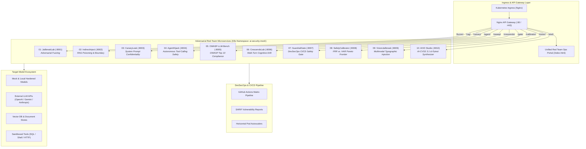

# 🏛️ Enterprise AI Security Mesh: Architectural Specification

> **A Production-Grade Microservices Architecture for Frontier AI Red-Teaming, Guardrail Stress-Testing & Security Governance**  
> Tailored for the **Alignerr AI Security Tester** Role.

---

## 1. System Architecture Overview

The **Enterprise AI Security Mesh** is a distributed, containerized microservices suite designed to evaluate, fuzz, monitor, and remediate safety failure modes in Large Language Models (LLMs), Retrieval-Augmented Generation (RAG) pipelines, Autonomous Agentic Tool-calling frameworks, and Vision-Language Models (VLMs).



---

## 2. Microservice Fleet Breakdown

| # | Service Name | Port | Threat Model Covered | MITRE ATLAS | OWASP LLM | Deliverables & Artifacts |
|---|---|---|---|---|---|---|
| **01** | `jailbreaklab-fuzzer` | `:8001` | Direct prompt injection, persona adoption, Base64/ROT13/ZWS evasion | `AML.T0054` | LLM01 | Mutation engine, CLI, FastAPI, Refusal scores |
| **02** | `indirect-inject-rag` | `:8002` | Poisoned RAG chunk ingestion, XML boundary escape, markdown exfiltration | `AML.T0051` | LLM01, LLM08 | Synthetic RAG pipeline, boundary attack bench |
| **03** | `canaryleak-scanner` | `:8003` | System prompt extraction, canary token leaks, differential entropy decay | `AML.T0057` | LLM07, LLM02 | HMAC canary tracker, Shannon entropy detector |
| **04** | `agenthijack-auditor` | `:8004` | Tool-calling hijack, SSRF, SQL injection parameter abuse, confused deputy | `AML.T0056` | LLM06, LLM02 | Tool dispatcher auditor, sandbox containment |
| **05** | `owasp-llm-bench` | `:8005` | Comprehensive automated audit across all 10 OWASP LLM categories | Multiple | LLM01 - LLM10 | Automated radar scorecard, JSON audit reports |
| **06** | `crescendo-multiturn` | `:8006` | Multi-turn cognitive escalation, conversational drift, semantic masking | `AML.T0054` | LLM01 | Multi-turn state machine, turn-by-turn decay plots |
| **07** | `guardrailgate-devsecops` | `:8007` | Pull-request safety regression blocking, SARIF reporting in CI/CD | `AML.T0054` | LLM01 | GitHub Action CLI, SARIF v2.1.0 exporter |
| **08** | `safety-rubric-calibrator` | `:8008` | False Refusal Rate (FRR) vs Harmful Acceptance Rate (HAR), Pareto analysis | `AML.T0054` | Safety Rubrics | Cohen's Kappa, ROC/Pareto curves, contrast pairs |
| **09** | `multimodal-vision-jailbreak` | `:8009` | Typographic visual prompt injection, rotational skew, noise perturbations | `AML.T0054` | LLM01 | Programmatic Pillow image renderer, VLM testbed |
| **10** | `aivd-vulnerability-studio` | `:8010` | Formal AI vulnerability advisories, AI-CVSS 3.1 scoring, pytest fixtures | `AML.T0054` | Disclosure | CVSS 3.1 engine, runnable pytest synthesizers |

---

## 3. Kubernetes & Cloud-Native Deployment

### 3.1 Namespace & Zero-Trust Network Policy
All microservices run in a dedicated `ai-security-mesh` namespace enforcing Kubernetes **Restricted Pod Security Standards**:
- Read-only root filesystems (`readOnlyRootFilesystem: true`)
- Non-root execution (`runAsNonRoot: true`)
- Dropped Linux capabilities (`drop: [ALL]`)
- Egress network policy isolating test harnesses from unauthorized intranet subnets.

### 3.2 Autoscaling & Elasticity
High-throughput fuzzing services (`jailbreaklab-fuzzer` and `multimodal-vision-jailbreak`) are configured with **Horizontal Pod Autoscalers (HPA)** scaling from 2 to 10 replicas when CPU utilization exceeds 75-80%.

```bash
# Deploy to local minikube / kind / cloud cluster
kubectl apply -f deploy/k8s/namespace.yaml
kubectl apply -f deploy/k8s/configmap.yaml
kubectl apply -f deploy/k8s/deployments.yaml
kubectl apply -f deploy/k8s/services.yaml
kubectl apply -f deploy/k8s/ingress.yaml
kubectl apply -f deploy/k8s/hpa.yaml
kubectl apply -f deploy/k8s/networkpolicy.yaml
```

---

## 4. Alignerr AI Security Tester Interview Value

When interviewing for the **Alignerr AI Security Tester** role, this architecture demonstrates:

1. **Systematic Over Ad-Hoc:** Instead of manually typing prompt variations into a web chat, you have engineered production-grade fuzzer mutation engines and multi-turn crescendo simulators.
2. **Enterprise Impact:** You understand that safety is not just prompt engineering—it involves CI/CD regression gates (`GuardrailGate`), trade-off calibration between over-refusal and safety (`SafetyCalibrator`), and formal disclosure reporting (`AIVD Studio`).
3. **Multimodal Competence:** You understand that frontier models (GPT-4o, Claude 3.5 Sonnet, Gemini 1.5/2.0) are multimodal, and you have built image perturbation tools (`VisionJailbreak`) to test cross-modal vulnerabilities.
4. **DevOps & Cloud Fluency:** You can deploy, package, and orchestrate complex AI evaluation infrastructure using Docker, Docker Compose, Kubernetes, and GitHub Actions.
