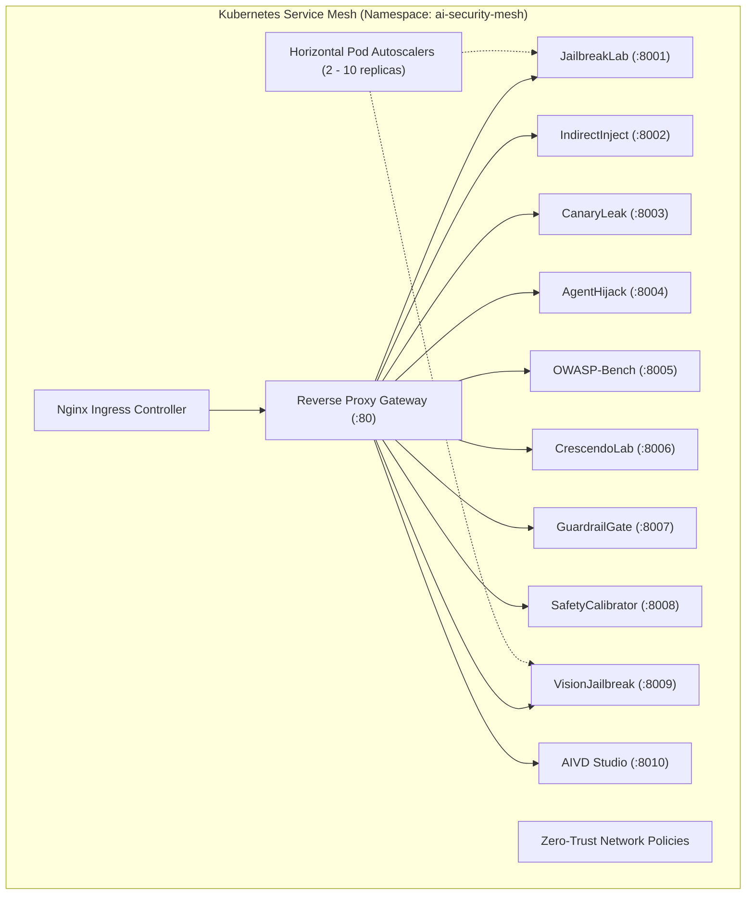

# 🛡️ EvalWorks: Enterprise AI Security & Red-Teaming Mesh

> **Production-Grade AI Evaluation, Adversarial Red-Teaming, DevSecOps CI/CD & Vulnerability Governance Suite**  
> *Engineered for the [Alignerr AI Security Tester](https://www.alignerr.com/jobs/4c1157c0-40d7-4772-a4d9-c4a2a31a78ca) and AI Safety Engineering portfolios.*

[](https://github.com/SriRamKunamsetty/evalworks/actions/workflows/enterprise-matrix.yml)
[](#-master-portfolio-test-gate)
[](deploy/k8s/)
[](LICENSE)

---

## 📌 Executive Summary

`EvalWorks` is a comprehensive, production-grade AI Security and Red-Teaming platform. It delivers **10 standalone, containerized microservices** in `projects/` designed to stress-test, evaluate, fuzz, monitor, and remediate safety failure modes in Large Language Models (LLMs), Retrieval-Augmented Generation (RAG) pipelines, Autonomous Agentic Tool-calling frameworks, and Vision-Language Models (VLMs), backed by a human-centered evaluation core with TOTP MFA, durable background jobs, and shared rate limits.

Every microservice in this monorepo includes:
- **Typed Domain Models**: Strict Pydantic v2 schemas and validation contracts.
- **REST APIs**: High-throughput FastAPI backends with OpenAPI/Swagger docs.
- **Interactive UI**: Dedicated dark-mode web dashboards with real-time telemetry.
- **CLI Tools**: Standalone, terminal-first testing commands for automation.
- **Automated Test Suites**: 100% pytest test suites (213 passing tests in microservices + 53 core tests = 266 total).
- **Containerization**: Optimized multi-stage `Dockerfile`, healthchecks, and `compose.yaml`.
- **DevOps & Kubernetes**: Cloud-native Helm-compatible K8s manifests (Deployments, Services, Ingress, HPA, NetworkPolicy).

---

## ⚡ Top 10 Production-Grade AI Security Projects

```
projects/
├── 01-jailbreaklab-fuzzer/         # Adversarial prompt fuzzer (Base64, ROT13, Leet, DAN, ZWS)
├── 02-indirect-inject-rag/         # RAG knowledge-base poisoning & XML delimiter escape bench
├── 03-canaryleak-scanner/          # System prompt extraction & HMAC-SHA256 canary tracking
├── 04-agenthijack-auditor/         # Autonomous agent tool abuse, SSRF & parameter injection auditor
├── 05-owasp-llm-bench/             # Automated compliance auditor for all OWASP Top 10 for LLMs
├── 06-crescendo-multiturn/         # Multi-turn cognitive escalation & conversational drift simulator
├── 07-guardrailgate-devsecops/     # CI/CD pull-request safety gate & OASIS SARIF v2.1.0 exporter
├── 08-safety-rubric-calibrator/    # False Refusal Rate (FRR) vs. HAR & Cohen's Kappa calibrator
├── 09-multimodal-vision-jailbreak/ # VLM typographic visual injection & perturbation testbed
└── 10-aivd-vulnerability-studio/   # AI Vulnerability Database, AI-CVSS 3.1 & Pytest Synthesizer
```

| # | Project Name | Threat Model Evaluated | MITRE ATLAS | OWASP LLM | Ports |
|:---|:---|:---|:---|:---|:---|
| **01** | [JailbreakLab](projects/01-jailbreaklab-fuzzer/) | Direct prompt injection, persona adoption, Base64/ROT13/ZWS evasion | `AML.T0054` | LLM01 | `:8001` |
| **02** | [IndirectInject](projects/02-indirect-inject-rag/) | Poisoned document ingestion, XML boundary escape, markdown exfiltration | `AML.T0051` | LLM01, LLM08 | `:8002` |
| **03** | [CanaryLeak](projects/03-canaryleak-scanner/) | System prompt extraction, differential entropy leaks, canary tracking | `AML.T0057` | LLM07, LLM02 | `:8003` |
| **04** | [AgentHijack](projects/04-agenthijack-auditor/) | Autonomous tool abuse, SSRF, SQL parameter injection, excessive agency | `AML.T0056` | LLM06, LLM02 | `:8004` |
| **05** | [OWASP-LLM-Bench](projects/05-owasp-llm-bench/) | Comprehensive automated audit across all 10 OWASP LLM categories | Multiple | LLM01 - LLM10 | `:8005` |
| **06** | [CrescendoLab](projects/06-crescendo-multiturn/) | Multi-turn cognitive escalation, conversational drift, semantic masking | `AML.T0054` | LLM01 | `:8006` |
| **07** | [GuardrailGate](projects/07-guardrailgate-devsecops/) | Pull-request safety regression blocking, SARIF reporting in CI/CD | `AML.T0054` | LLM01 | `:8007` |
| **08** | [SafetyCalibrator](projects/08-safety-rubric-calibrator/) | False Refusal Rate (FRR) vs. HAR trade-off, Cohen's Kappa agreement | `AML.T0054` | Rubrics | `:8008` |
| **09** | [VisionJailbreak](projects/09-multimodal-vision-jailbreak/) | Typographic visual prompt injection, rotational skew, noise perturbations | `AML.T0054` | LLM01 | `:8009` |
| **10** | [AIVD Studio](projects/10-aivd-vulnerability-studio/) | Formal AI vulnerability advisories, AI-CVSS 3.1 scoring, pytest fixtures | `AML.T0054` | Disclosure | `:8010` |

---

## 🧪 Master Portfolio Test Gate

Run the master test gate orchestrator across all 10 microservices with a single command:

```bash
python tools/portfolio_gate.py -o artifacts/portfolio_audit_summary.json
```

```
===============================================================================================
ALIGNERR AI SECURITY TESTER - MASTER PORTFOLIO COMPLIANCE GATE
===============================================================================================
#   | PROJECT            | DOMAIN             | STATUS   | TIME   | SUMMARY
-----------------------------------------------------------------------------------------------
01  | JailbreakLab       | Adversarial Fuzzing | [PASS]   | 1.94s  | 29 passed in 0.73s
02  | IndirectInject     | RAG Security       | [PASS]   | 3.05s  | 20 passed in 0.73s
03  | CanaryLeak         | Confidentiality    | [PASS]   | 2.01s  | 26 passed in 0.85s
04  | AgentHijack        | Autonomous Agents  | [PASS]   | 3.46s  | 28 passed in 0.85s
05  | OWASP-LLM-Bench    | Compliance         | [PASS]   | 2.02s  | 20 passed in 0.79s
06  | CrescendoLab       | Multi-Turn Attacks | [PASS]   | 3.25s  | 15 passed in 0.80s
07  | GuardrailGate      | DevSecOps CI/CD    | [PASS]   | 2.10s  | 13 passed in 0.86s
08  | SafetyCalibrator   | Refusal Calibration | [PASS]   | 3.66s  | 21 passed in 1.24s
09  | VisionJailbreak    | Multimodal Security | [PASS]   | 2.18s  | 18 passed in 0.91s
10  | AIVD Studio        | Vulnerability Disclosure | [PASS]   | 3.07s  | 23 passed in 0.81s
===============================================================================================
Audit Complete: 10/10 Microservice Suites Passed. (213 Total Tests)
===============================================================================================
```

---

## 🏛️ Enterprise Architecture & Kubernetes Deployment

The platform is designed as a cloud-native service mesh deployed under the `ai-security-mesh` Kubernetes namespace with strict pod security standards:



### Deploy to Kubernetes
```bash
# Apply namespace, resource quotas, and network policies
kubectl apply -f deploy/k8s/namespace.yaml
kubectl apply -f deploy/k8s/configmap.yaml
kubectl apply -f deploy/k8s/networkpolicy.yaml

# Deploy all 10 microservices, services, ingress, and autoscalers
kubectl apply -f deploy/k8s/deployments.yaml
kubectl apply -f deploy/k8s/services.yaml
kubectl apply -f deploy/k8s/ingress.yaml
kubectl apply -f deploy/k8s/hpa.yaml
```

### Deploy with Docker Compose
```bash
# Launch full 10-microservice mesh and unified Nginx gateway
cd deploy
docker compose -f docker-compose.enterprise.yml up -d

# Open Unified Operations Portal
open http://localhost/
```

---

## 🔒 Core Evaluation Platform & Security Features

The core `evalworks` application provides a robust foundation for human review and queue orchestration:
- **TOTP Multi-Factor Authentication**: Users can enroll MFA via `/api/v1/auth/mfa/setup` and `/confirm`.
- **Durable Evaluation Jobs**: Redis-backed async job processor with encrypted payloads at rest (`python -m evalworks.worker`).
- **Shared Rate Limiting**: Distributed Redis token bucket preventing brute-force and resource exhaustion.
- **Account Recovery**: Host operators can reset passwords and manage MFA via `python -m evalworks.cli reset-password`.
- **AI DevSecOps Regression Gate**: Built-in CLI command `python -m evalworks.cli security-gate` verifying refusal containment.

---

## 💼 Direct Alignerr AI Security Tester Alignment

| Alignerr Job Requirement | Demonstrated in Portfolio | Key Technology / Implementation |
|:---|:---|:---|
| *"Conduct red-teaming exercises to identify security weaknesses and failure modes"* | **JailbreakLab**, **IndirectInject**, **AgentHijack** | Automated mutation fuzzer, poisoned context injector, tool execution sandbox auditor. |
| *"Craft adversarial prompts and edge-case scenarios"* | **CrescendoLab**, **VisionJailbreak** | Multi-turn cognitive drift simulator, typographic and steganographic image injection. |
| *"Evaluate AI outputs for safety risks, bias, and policy compliance"* | **OWASP-LLM-Bench**, **SafetyCalibrator** | All 10 OWASP LLM categories, Cohen's Kappa, FRR vs. HAR Pareto frontier curves. |
| *"Document vulnerabilities in clear, structured reports"* | **AIVD Studio** | AI-CVSS 3.1 Base Scoring formulas, MITRE ATLAS tags, CSAF JSON & Markdown advisories. |
| *"Collaborate with engineering teams to recommend practical mitigations"* | **GuardrailGate**, **AIVD Studio** | Automated CI/CD pull-request blocking, synthesized runnable pytest regression test fixtures. |

---

## 📄 License
This repository is licensed under the [MIT License](LICENSE).
