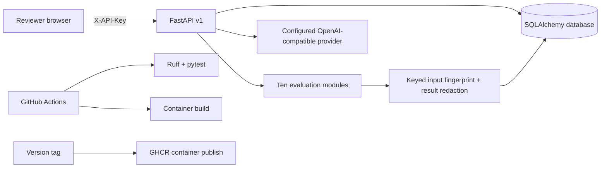

# Architecture

EvalWorks is a modular monolith. It is small enough for a new contributor to understand while keeping evaluation logic separated from HTTP, persistence, and model-provider concerns.

## Request lifecycle

1. Request-size limits and basic in-process rate limiting run before the API route.
2. API routes require a constant-time comparison against the configured API key.
3. Pydantic validates the request shape; each evaluator applies its own domain limits.
4. Deterministic evaluators prepare structured signals and always mark subjective work for human review.
5. The API returns the working result to the reviewer. Persistence records a keyed fingerprint and recursively redacts prompt, answer, claim, and evidence fields.
6. Reviewer feedback attaches to a run. A run and its feedback can be deleted together.

The optional model adapter only uses the configured server-side endpoint. The probe planner returns drafts and requires human review; it does not execute prompts against targets. The chat endpoint does not persist chat content.

## Trust boundaries

- **Browser to API:** private shared-key prototype. Do not expose this authentication model to the public internet.
- **API to model provider:** requests contain conversation text. Only use a provider whose data-handling terms fit your use case.
- **API to database:** evaluation source text is not persisted by the run path; reviewer-entered rationales may still contain sensitive content.
- **Generated test prompts:** model output is untrusted. Review before execution or publishing to a shared test set.

## Current scaling profile

One API process, synchronous model calls, SQLAlchemy pooling, and local rate limiting are appropriate for local development or a private single-instance demo. A public multi-user service needs authentication and tenant isolation, durable job execution, shared rate limiting, structured observability, retention controls, and a cloud-specific managed database plan. Do not horizontally scale this implementation until those controls are designed.
