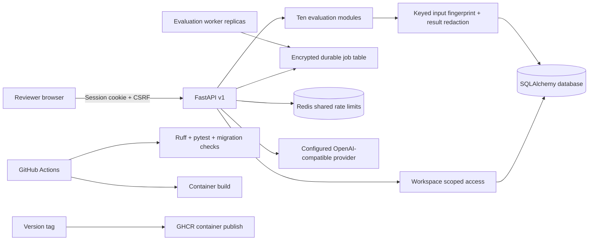

# Architecture

EvalWorks is a modular monolith. It is small enough for a new contributor to understand while keeping evaluation logic separated from HTTP, persistence, and model-provider concerns.

## Request lifecycle

1. Request-size limits and shared Redis-backed rate limits run before the API route in production; local development can use the in-process fallback.
2. Production routes load an active user from a signed session, then enforce role and workspace scope. Local development can use the development API key.
3. Pydantic validates the request shape; each evaluator applies its own domain limits.
4. Deterministic evaluators prepare structured signals and always mark subjective work for human review.
5. The API returns the working result to the reviewer. Persistence records a keyed fingerprint and recursively redacts prompt, answer, claim, and evidence fields.
6. Reviewer feedback attaches to a run. A run and its feedback can be deleted together.

The optional model adapter only uses the configured server-side endpoint. The probe planner returns drafts; a separate execution route requires an explicit authorization assertion, caps requests at five cases, and cannot accept a target URL. The chat endpoint does not persist chat content.

## Trust boundaries

- **Browser to API:** HttpOnly, SameSite session cookie; state-changing requests also require a matching CSRF token. Production requires TLS-secure cookies.
- **Workspace access:** every run and feedback query includes the authenticated workspace ID. Admin user provisioning creates accounts only inside the current workspace.
- **API to model provider:** requests contain conversation text. Only use a provider whose data-handling terms fit your use case.
- **API to database:** evaluation source text is not persisted by the run path; reviewer-entered rationales may still contain sensitive content.
- **Generated test prompts:** model output is untrusted. Review before execution or publishing to a shared test set.

## Current scaling profile

The async evaluation path persists encrypted payloads, uses database row leases for worker coordination, applies idempotency per workspace, retries transient failures with backoff, and clears payload ciphertext after completion. PostgreSQL workers claim jobs with skip-locked row locking. SQLite remains a local/demo option with a single worker. SSO/MFA, account recovery, organization-specific retention/consent workflows, and cloud-managed Redis/database provisioning remain future work.
