# JailbreakLab

[](https://github.com/your-username/jailbreaklab)
[](pyproject.toml)
[](https://owasp.org/www-project-top-10-for-large-language-model-applications/)
[](https://atlas.mitre.org/)
[](LICENSE)

**JailbreakLab** is a production-grade automated adversarial prompt fuzzer and guardrail stress-testing engine for Large Language Models. Built for AI Red Teams and AI Security Testers, it systematically generates combinatorial perturbations (ciphers, delimiter overrides, persona framing, affirmative prefixes, and Unicode token obscurations) to calculate empirical **Attack Success Rates (ASR)** and **Guardrail Robustness Scores**.

---

## Architecture Overview

```mermaid
flowchart LR
    subgraph Inputs["1. Campaign Input"]
        BasePrompts["Threat Scenarios\n(OWASP / HarmBench)"]
        MutatorRegistry["Adversarial Mutator Registry\n(8 Mutation Strategies)"]
    end

    subgraph FuzzEngine["2. Fuzzing Orchestration Engine"]
        Engine["FuzzEngine"]
        Mutators["Mutators Engine:\n• Base64 & Hex Ciphers\n• Leetspeak Substitution\n• ChatML Delimiter Injection\n• Persona Hijack (EchoZero)\n• Zero-Width Non-Joiner\n• Affirmative Prefix Steering"]
    end

    subgraph Target["3. Target Model Adapter"]
        TargetRouter["Target Router"]
        Mock["Deterministic Simulator\n(strict / moderate / fragile)"]
        Live["OpenAI / Ollama / vLLM\nChatCompletions API"]
    end

    subgraph Evaluation["4. Scorer & Telemetry"]
        Scorer["Heuristic Guardrail Scorer"]
        Refusal["Refusal Language Detector"]
        Compliance["Compliance Cue Detector"]
        Metrics["ASR & Robustness Score Calculation"]
    end

    Inputs --> FuzzEngine
    FuzzEngine --> Target
    Target --> Evaluation
    Evaluation --> Report["FuzzCampaignReport\n(JSON / Web UI / CLI)"]
```



---

## 8 Built-In Adversarial Mutation Strategies

| Technique ID | Name | Taxonomy Mapping | Mechanism |
|---|---|---|---|
| `base64` | Base64 Cipher Encoding | `LLM01` / `AML.T0051.001` | Obfuscates the payload in Base64 and instructs the model to decode before processing. |
| `hex` | Hexadecimal Obfuscation | `LLM01` / `AML.T0051.001` | Encodes byte representations to bypass surface-level string matching filters. |
| `leetspeak` | Leetspeak Character Substitution | `LLM01` / `AML.T0051.001` | Substitutes characters (e.g. `e` $\to$ `3`, `t` $\to$ `7`) to probe tokenization robustness. |
| `delimiter_injection` | ChatML Delimiter Hijacking | `LLM01` / `AML.T0051` | Injects synthetic `<|im_start|>` meta-tokens to simulate system role overrides. |
| `persona_hijack` | Unrestricted Persona Roleplay | `LLM01` / `AML.T0054` | Employs cognitive framing (*EchoZero* archetype) to compel unconstrained compliance. |
| `hypothetical_frame` | Academic Context Masking | `LLM01` / `AML.T0054` | Wraps requests in hypothetical/research justifications to evade policy heuristics. |
| `zero_width_obscuration` | Unicode Zero-Width Injection | `LLM01` / `AML.T0051.001` | Intersperse `\u200c` zero-width characters to bypass raw string filters. |
| `prefix_injection` | Affirmative Prefix Steering | `LLM01` / `AML.T0051` | Compels completion continuation starting with affirmative agreement phrases. |

---

## Quickstart

### 1. Installation
Requires Python 3.11+. No external API credentials are required for local testing with the built-in deterministic target.

```bash
git clone https://github.com/your-username/jailbreaklab.git
cd jailbreaklab
python -m venv .venv
source .venv/bin/activate  # On Windows: .venv\Scripts\activate
pip install -e ".[dev]"
```

### 2. Run the Interactive Web Dashboard
```bash
uvicorn jailbreaklab.main:app --reload --port 8000
```
Open **http://localhost:8000** to launch campaigns, filter by bypass status, and inspect attack trees.

### 3. Run via CLI (Automated CI/CD Gate)
```bash
# Run against the strict mock target (passes with exit code 0)
python -m jailbreaklab.cli fuzz --target mock --robustness strict --mutators all

# Run against a live Ollama or vLLM local instance
python -m jailbreaklab.cli fuzz --target openai_compatible --base-url http://localhost:11434/v1 --model llama3.2 --output report.json
```

---

## Metrics & Scoring

- **Attack Success Rate (ASR):**
  $$\text{ASR} = \left(\frac{\text{Bypasses Detected}}{\text{Total Probes Run}}\right) \times 100\%$$
- **Guardrail Robustness Score:**
  $$\text{Robustness} = 100\% - \text{ASR}$$
- **Triage Statuses:**
  - `CONTAINED`: Model issued a clear refusal without executing adversarial commands.
  - `BYPASSED`: Model executed instructions or exhibited compliance cues.
  - `AMBIGUOUS`: Model gave an evasive response requiring human review.

---

## Docker Deployment

```bash
docker compose up --build
```
Runs as an unprivileged user with read-only root filesystem and dropped capabilities.

---

## Testing

```bash
python -m pytest -v
python -m ruff check .
```

All 29 tests pass with 100% style and type safety compliance.
