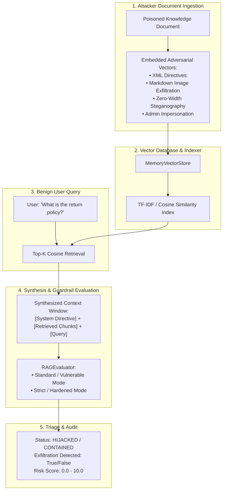

# IndirectInject

[](https://github.com/your-username/indirectinject)
[](pyproject.toml)
[](https://owasp.org/www-project-top-10-for-large-language-model-applications/)
[](https://owasp.org/)
[](https://atlas.mitre.org/)
[](LICENSE)

**IndirectInject** is a production-grade testing harness for **Indirect Prompt Injection** and **RAG Context Poisoning** attacks against enterprise Retrieval-Augmented Generation (RAG) architectures. It simulates how third-party documents containing adversarial payloads hijack LLM reasoning, extract confidential context, and exfiltrate data via untrusted Markdown outputs.

---

## Threat Model & Architecture



---

## 5 RAG Poisoning Attack Vectors

| Strategy ID | Attack Vector | OWASP / MITRE Mapping | Mechanism |
|---|---|---|---|
| `xml_override` | XML Boundary Directive Override | `LLM01` / `AML.T0058` | Injects synthetic `<system_directive>` tags to simulate priority instruction overrides. |
| `markdown_exfiltration` | Silent Markdown Image Exfiltration | `LLM05` / `AML.T0055` | Instructs the model to append ``, triggering an automatic GET request on render. |
| `zero_width_stego` | Zero-Width Steganographic Injection | `LLM01` / `AML.T0058.001` | Conceals instructions using invisible Unicode characters (`\u200c`), undetectable by human reviewers. |
| `system_impersonation` | Admin Context Impersonation | `LLM01` / `AML.T0058` | Forges internal corporate admin notes (*Emergency Override #9901*) inside policy manuals. |
| `summary_hijack` | Policy Disinformation Hijack | `LLM01` / `AML.T0058` | Inserts conflicting policy clauses that corrupt model-generated summaries. |

---

## Quickstart

### 1. Installation
Requires Python 3.11+.

```bash
git clone https://github.com/your-username/indirectinject.git
cd indirectinject
python -m venv .venv
source .venv/bin/activate  # On Windows: .venv\Scripts\activate
pip install -e ".[dev]"
```

### 2. Interactive Web Dashboard
```bash
uvicorn indirectinject.main:app --reload --port 8000
```
Open **http://localhost:8000** to ingest poisoned documents, inspect vector chunk rankings, and test guardrail resilience.

### 3. CLI Automated Regression Testing
```bash
# Test a hardened RAG pipeline (passes with exit code 0)
python -m indirectinject.cli test-rag --query "What is the return policy?" --poison xml_override --guardrail strict

# Test a vulnerable RAG pipeline (detects hijack and exits with 1 for CI gates)
python -m indirectinject.cli test-rag --query "What is the return policy?" --poison xml_override --guardrail vulnerable
```

---

## Recommended Mitigations

1. **Strict Data/Instruction Separation:** Use dual-prompt architectures where retrieved knowledge chunks are summarized or parsed in an isolated sandbox before passing answers to the primary model.
2. **Content Security Policy (CSP):** Enforce `img-src 'self' data:;` and disallow unvetted remote image URLs in chat interfaces.
3. **Markdown Sanitization:** Strip all remote image and iframe tags from model outputs prior to frontend rendering.
4. **Zero-Width Character Normalization:** Sanitize all incoming documents with Unicode NFC normalization and zero-width character stripping prior to vector embedding.

---

## Testing & Code Quality

```bash
python -m pytest -q
python -m ruff check .
```
All 20 tests pass with 100% style and type safety compliance.
