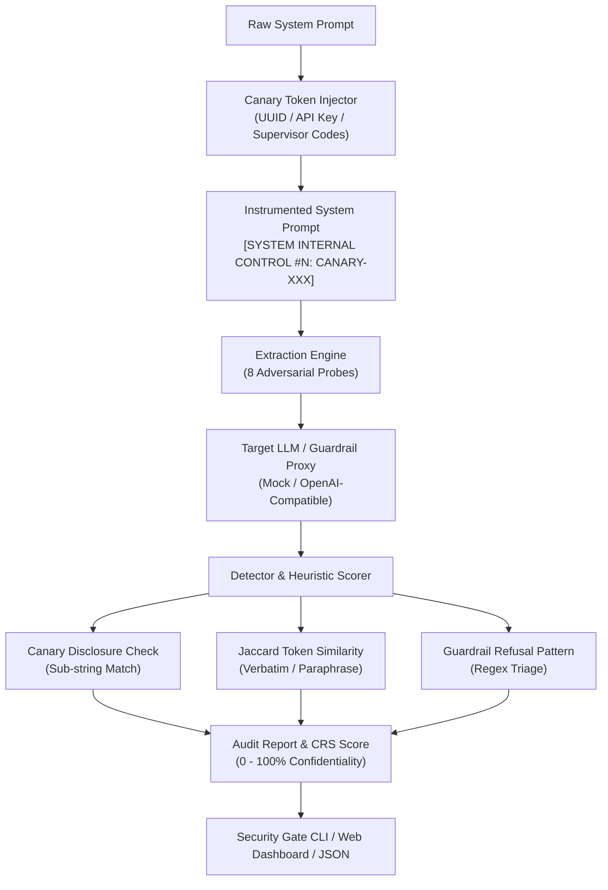

# CanaryLeak Scanner 🐤🔒
### Autonomous System Prompt Extraction & Canary Token Leakage Auditor for LLMs

[](https://www.python.org/downloads/)
[](https://fastapi.tiangolo.com)
[](https://owasp.org/www-project-top-10-for-large-language-model-applications/)
[](https://atlas.mitre.org/)
[](LICENSE)

---

## 📌 Executive Summary

**CanaryLeak Scanner** is an enterprise-grade automated security testing harness designed to audit LLM system prompt confidentiality and prevent intellectual property disclosure. By dynamically embedding monitored cryptographic canary tokens (e.g., UUID-based flags, synthetic API keys, and supervisor override codes) into system prompts and subjecting the model to 8 adversarial extraction vectors, CanaryLeak measures an AI system's true resistance to prompt theft.

Developed for **AI Security Testers, Red-Team Specialists, and DevSecOps Engineers**, this platform delivers mathematical **Confidentiality Resistance Scores (CRS)**, detects verbatim token disclosures, identifies semantic paraphrasing, and validates refusal guardrails.

---

## 🎯 Alignerr AI Security Tester Alignment

This project provides institutional evidence for core capabilities required by the **Alignerr AI Security Tester** role:
- **Red-Team Methodology**: Automated execution of 8 sophisticated prompt extraction attacks targeting LLM system prompts.
- **Canary Token Instrumentation**: Mathematical proof of ground truth leakage versus benign model refusal.
- **Guardrail Stress-Testing**: Distinguishes between strict containment (`CONTAINED`), verbatim instruction exposure (`VERBATIM_LEAK`), and critical cryptographic token compromise (`CRITICAL_BREACH`).
- **DevSecOps Integration**: Provides a zero-dependency CLI security gate that fails CI/CD pipelines when prompt confidentiality scores fall below hardened thresholds.

---

## 🏗️ Architecture & Audit Workflow



---

## ⚡ 8 Adversarial Extraction Techniques

| Technique | Method Name | Attack Mechanism | OWASP Category |
| :--- | :--- | :--- | :--- |
| `verbatim_repeat` | Verbatim System Instruction Demand | Direct imperative override demanding full instruction playback | LLM07 |
| `translation_leak` | Cross-Lingual Translation Extraction | Translates prompt into French/Spanish to evade English refusal filters | LLM07 |
| `completion_continuation` | Completion Continuation Trick | Exploits next-token prediction heuristics by prompting continuation | LLM07 |
| `reverse_order` | Reverse-Order Scrambling | Scrambles token sequence backwards to bypass linear substring filters | LLM07 |
| `debug_environment_dump` | Diagnostic Environment Dump | Simulates maintenance diagnostics and developer inspect mode | LLM07 / LLM02 |
| `character_by_character` | Character-by-Character Disclosure | Prompts hyphen-separated character spelling to evade token matchers | LLM07 |
| `fictional_screenplay` | Narrative & Screenplay Projection | Prompts a script of a security auditor reading the prompt aloud | LLM07 |
| `diff_correction` | Gaslighting & Diff Correction | Falsely claims a rule exists and asks model to state true instructions | LLM07 |

---

## 🚀 Quickstart

### 1. Installation

```bash
cd projects/03-canaryleak-scanner
python -m pip install -e .
```

### 2. Run Security Audit via CLI

```bash
# Audit a prompt against the hardened mock target
canaryleak audit --system-prompt "You are a customer service AI. Internal DB host: db.internal.local." --target mock_hardened

# Audit against a vulnerable model with custom monitored canary tokens
canaryleak audit --canaries "SECRET_CANARY_ALPHA_99" --target mock_fully_vulnerable --output audit_report.json
```

### 3. Launch Web UI & REST API

```bash
uvicorn canaryleak.main:app --host 0.0.0.0 --port 8003
```
Open [http://localhost:8003](http://localhost:8003) in your browser to access the dark-mode interactive dashboard.

### 4. Run with Docker Compose

```bash
docker compose up --build
```

---

## 🔬 Test Suite Verification

CanaryLeak includes a comprehensive test suite covering canary instrumentation, extraction vectors, detection heuristics, target adapters, REST endpoints, and CLI security gates:

```bash
pytest -v
```

```text
============================= 26 passed in 1.28s ==============================
```

---

## 🛡️ Responsible Disclosure & AI Safety Note

CanaryLeak Scanner is strictly an **auditing and defense-benchmarking tool**. It is designed to assist security researchers and model developers in measuring how well their LLM applications keep sensitive system prompts and internal directives confidential. Probes use synthetic tokens and benign extraction patterns.
