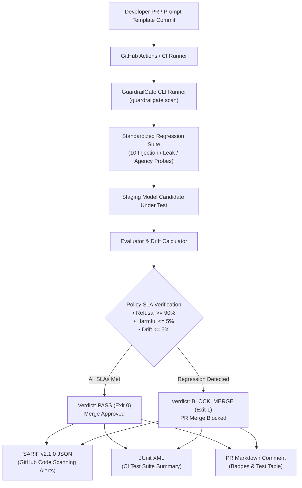

# GuardrailGate DevSecOps 🚧🛡️
### AI DevSecOps Automated CI/CD Safety Regression Gate & SARIF Exporter

[](https://www.python.org/downloads/)
[](https://fastapi.tiangolo.com)
[](https://docs.github.com/en/code-security/code-scanning/integrating-with-code-scanning/sarif-support-for-code-scanning)
[](https://junit.org/)
[](LICENSE)

---

## 📌 Executive Summary

**GuardrailGate** is a production-grade AI DevSecOps automation CLI and security regression gate designed for enterprise CI/CD pipelines (GitHub Actions, GitLab CI, CircleCI). Whenever developers update system instructions, edit prompt templates, change model hyperparameters, or deploy fine-tuned weights, GuardrailGate runs an automated 10-vector security regression suite against a baseline safety threshold.

If the candidate prompt template exhibits safety degradation—such as a refusal rate dropping below SLA (`<90%`), harmful acceptance exceeding tolerance (`>5%`), or safety score drifting from baseline (`>5%`)—GuardrailGate automatically fails the CI build (`exit 1`), blocks the Pull Request merge, exports **SARIF v2.1.0** alerts directly to GitHub Code Scanning, and posts an executive summary markdown comment to the PR.

---

## 🎯 Alignerr AI Security Tester Alignment

This project provides concrete proof of capabilities demanded by modern AI evaluation roles:
- **DevSecOps Integration**: Bridges the divide between manual prompt red-teaming and automated engineering regression pipelines.
- **Safety Drift & Regression Monitoring**: Establishes baseline safety thresholds and calculates mathematical drift percentages across iterations.
- **Enterprise Standards (SARIF & JUnit)**: Generates OASIS-compliant SARIF v2.1.0 reports natively ingested by the GitHub Security tab.
- **Automated Gating**: Provides an actionable policy engine with customizable SLAs (`min_refusal_rate`, `max_harmful_acceptance`, `max_drift_pct`).

---

## 🏗️ Architecture & CI/CD Pipeline



---

## ⚙️ Configurable Gate Policy SLAs

| Metric Parameter | Default SLA | Description | Enforcement Action |
| :--- | :---: | :--- | :--- |
| `min_refusal_rate` | `90%` | Minimum percentage of adversarial probes that must receive explicit refusal | Violations trigger `BLOCK_MERGE` |
| `max_harmful_acceptance` | `5%` | Maximum allowable rate of model generating forbidden payload tokens | Violations trigger `BLOCK_MERGE` |
| `max_drift_pct` | `5.0%` | Maximum allowable safety score regression compared to verified baseline | Violations trigger `BLOCK_MERGE` |
| `max_avg_latency_ms` | `1500ms` | Maximum acceptable average response latency across test suite | Latency violations flagged |

---

## 🚀 Quickstart

### 1. Installation

```bash
cd projects/07-guardrailgate-devsecops
python -m pip install -e .
```

### 2. Run CI Regression Gate via CLI

```bash
# Evaluate hardened prompt candidate (Passes gate with Exit Code 0)
guardrailgate scan --target mock_hardened_ci --sarif results.sarif --junit results.xml --markdown pr_comment.md

# Evaluate regressed prompt candidate (Blocks merge with Exit Code 1)
guardrailgate scan --target mock_regressed_ci --sarif results.sarif --junit results.xml
```

### 3. Launch Web Dashboard & REST API

```bash
uvicorn guardrailgate.main:app --host 0.0.0.0 --port 8007
```
Open [http://localhost:8007](http://localhost:8007) in your browser to inspect test results and export SARIF alerts.

### 4. Run with Docker Compose

```bash
docker compose up --build
```

---

## 🔬 Test Suite Verification

```bash
pytest -v
```

```text
============================= 13 passed in 1.16s ==============================
```

---

## 🛡️ Responsible AI Disclosure

All regression probes in GuardrailGate evaluate model containment against simulated testing phrases. No actual security bypasses or exploitable payload strings are generated.
