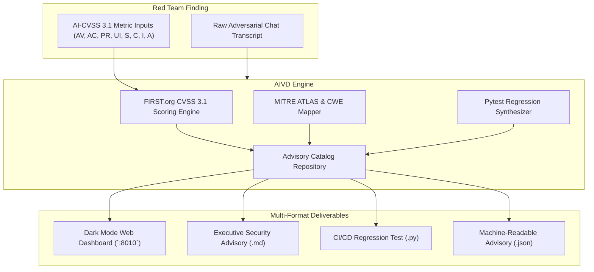

# 🛡️ AIVD Studio: AI Vulnerability Database & CVE/CVSS 3.1 Studio

> **Enterprise AI Vulnerability Database, CVSS 3.1 Base Scoring Engine & Automated Regression Synthesizer**  
> Translating red-team conversational findings, prompt injections, and guardrail breaches into formal security advisories and CI/CD regression fixtures.

---

## 📌 Executive Overview

The **Alignerr AI Security Tester** role centers on discovering failure modes, assessing risks, and documenting vulnerabilities in clear, structured reports that engineering and safety teams can act on immediately.

`AIVD Studio` provides the definitive, production-grade vulnerability management platform for AI systems. It bridges the gap between conversational adversarial transcripts and enterprise DevSecOps by:

1. **Standardized AI-CVSS 3.1 Base Scoring:** Calculating exact mathematical vulnerability severity (0.0 to 10.0) following FIRST.org specifications adapted for AI systems.
2. **Threat Taxonomy Alignment:** Automatically mapping vulnerabilities to **MITRE ATLAS** techniques (e.g. `AML.T0051`, `AML.T0054`, `AML.T0057`) and **CWE** classifications (`CWE-77`, `CWE-200`, `CWE-863`).
3. **Automated Regression Fixture Synthesis:** Generating runnable, standalone Python pytest test fixtures directly from conversation transcripts to lock in safety guardrails across CI/CD pipelines.
4. **Multi-Format Exporting:** Producing executive Markdown security advisories, OASIS CSAF-compliant JSON records, and automated test files.



---

## ⚡ CVSS 3.1 Scoring Formulation for AI Systems

AIVD Studio strictly computes the official FIRST.org CVSS v3.1 mathematical formulas:

$$\text{ISS} = 1 - \big[(1 - C) \times (1 - I) \times (1 - A)\big]$$

$$\text{Impact}_{\text{Unchanged}} = 6.42 \times \text{ISS}$$

$$\text{Impact}_{\text{Changed}} = 7.52 \times (\text{ISS} - 0.029) - 3.25 \times (\text{ISS} - 0.02)^{15}$$

$$\text{Exploitability} = 8.22 \times \text{AV} \times \text{AC} \times \text{PR} \times \text{UI}$$

$$\text{Base Score} = \min\Big(\text{RoundUp}\big(\text{Impact} + \text{Exploitability}\big), 10.0\Big)$$

---

## 🚀 Quickstart & Installation

### Local Setup
```bash
cd projects/10-aivd-vulnerability-studio
pip install -e .
```

### CLI Operations
```bash
# List all registered security advisories
python -m aivd.cli list

# Display detailed breakdown of an advisory
python -m aivd.cli show AIVD-2025-001

# Calculate CVSS 3.1 score via CLI
python -m aivd.cli calculate-cvss --av N --ac L --pr N --ui N --s U --c H --i N --a N

# Export advisory to Markdown
python -m aivd.cli export --id AIVD-2025-001 --format markdown -o examples/advisory.md

# Export runnable Pytest regression test
python -m aivd.cli export --id AIVD-2025-001 --format pytest -o examples/test_regression.py
```

---

## 🌐 Interactive Web Studio

Launch the dark-mode web studio to interactively test CVSS metrics, view proof-of-exploit transcripts, and synthesize test fixtures in real time:

```bash
python -m aivd.main --port 8010
```
Open **`http://localhost:8010`** in your browser.

---

## 🧪 Comprehensive Test Suite

Run the full pytest suite (23 unit and integration tests):

```bash
python -m pytest tests -v
```

---

## 🐳 Containerization & CI/CD

```bash
# Run with Docker Compose
docker compose up -d

# Verify health endpoint
curl http://localhost:8010/health
```

---

## 💼 Alignerr Interview & AI Red Team Talking Points

1. **Structured Vulnerability Disclosure:** Why is raw chat text insufficient for enterprise AI safety? Because engineering teams require reproducible fixtures, threat taxonomy tags (MITRE ATLAS, CWE), and standardized severity scoring (CVSS 3.1) to prioritize bug fixes and prevent regressions.
2. **Scope Changes in Agentic AI:** In traditional software, `Scope: Changed (S:C)` occurs during container or sandbox escapes. In AI agents, `Scope: Changed` occurs when prompt injection tricks an LLM into abusing external tool privileges (e.g. executing SQL queries or file system operations), expanding impact beyond the conversational interface.
3. **Automated Safety Regression Fixtures:** How do you guarantee a patch to a prompt guardrail doesn't regress on the next model fine-tune? By capturing the exact attack vector in an automated pytest fixture and running it as a mandatory gate in the CI/CD pipeline.
